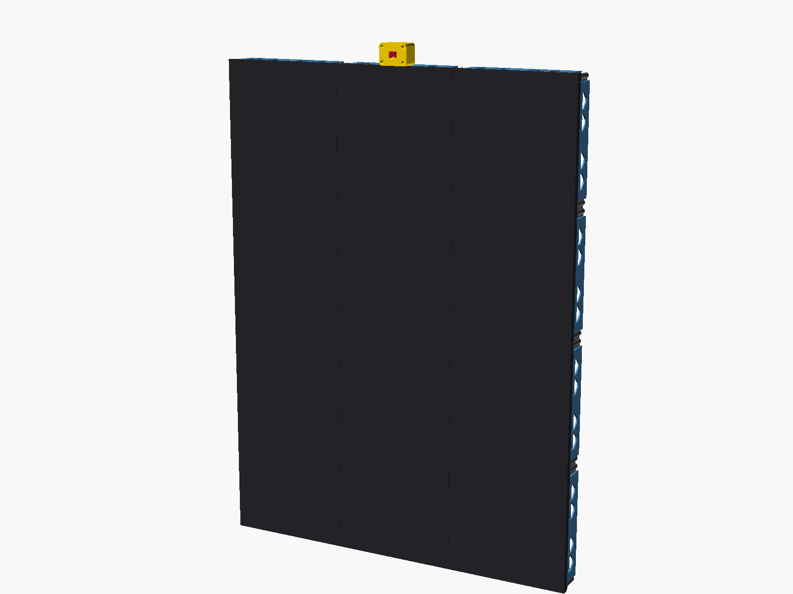

# House Fortuna wall

A wall of 64 x 64 HUB75 LED panels (the default build is 3 wide x 4 tall: 12 panels, 192 x 256 pixels, portrait)
driven by a Raspberry Pi 4 and controlled from a phone web app. It shows slow generative art, GPU shaders, a new
AI-composed piece every day, live pieces drawn from real data (aircraft, satellites, wind, snow, tides, trams) and art that
responds, gently, to the music in the room. It can also act as a camera mirror with AI one-liners and a receipt printer.
Everything runs on your own Pi; every outside service is optional. You can try it on a laptop with no hardware.

This repository is one household's wall (a flat in Zürich), published so that others can build their own. Some things in
it are personal and need changing: see [Make it yours](#make-it-yours).



## What it does

| Area | What you get | Needs |
|---|---|---|
| **Art gallery** | 67 pieces in 7 collections, plus every daily edition (33 shaders, 15 music visuals, plus hand-written pieces: marbling and op-art, lines and dots, long-exposure light, coral, ink and moire). Pace set in the app | Shaders need `moderngl` and an OpenGL context |
| **Art of the day** | One new shader a day, composed by an AI model after looking at a Pinterest mood board, checked for flicker, scored by a second call, then hung. Also published to a public site | An OpenAI or Anthropic key, or just fetch the author's pieces from his public gallery (default) |
| **Live boards** | Planes, Satellites, Wind over Switzerland, Ireland and Europe, Snow, Limmat river, West Cork lights, Tides, Earthquakes, Tram map (timetable-driven) and a split-flap Tram board (live departures). The app's *Live boards* chip is the current list | Internet, no keys. Most are tied to Zürich or West Cork: see [Make it yours](#make-it-yours) |
| **Music** | Art that follows the room's sound. A party slider from "art just breathes" to dance floor, a beat tracker, song names (Shazam, Cast speakers, Spotify), album-cover colours | A USB microphone on the Pi |
| **Mirror** | Camera silhouette, countdown photo, an AI one-liner, aura reading, pixel portrait, printed receipt, opt-in face recognition | A camera, an AI key. Printer optional |
| **Shows** | Pride show, Welcome, Dewa's Story, Maeva in Zürich, a message card, a Wheel of Fortuna that prints a verdict | Personal to the author: edit or delete them |
| **Room** | Smart Life (Tuya) lights: presets, brightness, warmth, colour, per light, lights-off time, import of rooms and scenes from the cloud (untested). Two Bluetooth LED rods that follow the wall | `tinytuya` and your device keys; `bleak` for the rods |
| **The app** | Phone web app: scenes, sleep timer, tour, gallery with search, live LED-dot preview, guest dedications by QR | Home Wi-Fi |
| **Public gallery** | Every day's piece on a GitHub Pages site with RSS, a play-with-it page per piece, and the control app online | A GitHub repo; see [docs/gallery.md](docs/gallery.md) |

## Try it in 5 minutes without hardware

You need Python 3.12 or 3.13 (3.13.17 was tested; the GitHub workflows use 3.12; older versions are untested), git, and a desktop session for the
simulator window.

```bash
git clone https://github.com/fionnf/magic-mirror.git
cd magic-mirror
python3 -m venv .venv      # Debian/Ubuntu: sudo apt install python3-venv first
.venv/bin/pip install -r requirements-dev.txt
./panel_setup/sim.sh
```

Then open <http://localhost:8080> in a browser (`PORT=8099 ./panel_setup/sim.sh` picks another port).

What you will see:
- the terminal prints the Flask server banner; the app is at `localhost:8080`;
- a pygame window titled "Magic Mirror Simulator - 192x256" (612 x 804 px at the default `SIM_SCALE = 3`; lower `SIM_SCALE` in `config.py` for a small screen)
  showing the wall: a "HOUSE FORTUNA" start-up screen with a progress bar, then the Art of the day (the default mode);
- the app: choose any mode and the window changes. **Lava & Coral**, **Shapes**, **Art Gallery**, **Artsy** and **Light Art** need nothing else.

Notes, honestly:
- **Install** took about 100 s on a plain Linux x86_64 machine with Python 3.13, all prebuilt wheels, no system libraries needed. This was run in a fresh venv, headless
  (`SDL_VIDEODRIVER=dummy`): the install succeeds and the app answers on port 8080. The pygame window itself needs a desktop session and was not checked there.
- **Shaders** (Art of the day, most of the gallery) need an OpenGL 3.3 context through `moderngl`. If none is available the log (`panel_setup/logs/daily.log`) says
  `[shaders] no GPU context` and those pieces draw black.
- **Microphone** (Music mode): the simulator streams the Mac's microphone with ffmpeg's `avfoundation` input (`MIC="..."` chooses one). On Linux or Windows there is no
  input unless you send 16-bit mono 22.05 kHz audio to UDP port 9099 yourself. **Webcam** (Mirror mode): the laptop's own.
- The simulator also runs the wall's background jobs, so it **writes into `assets/daily/`** (an offline piece for today, and it finishes the bundled past days).
  `git checkout assets/daily && git clean -fd assets/daily` puts that back. It also looks at the author's public gallery for today's piece (see [Make it yours](#make-it-yours)).
- AI features fall back to built-in text without a key. To try them, copy `.env.example` to `.env` and set `OPENAI_API_KEY`.

## Parts and wiring

| Part | Notes |
|---|---|
| Raspberry Pi 4 | The code and settings are for a Pi 4B. Upstream `rpi-rgb-led-matrix` does not support the Pi 5 (not tested here) |
| HUB75 driver board | Adafruit RGB Matrix Bonnet (3 HUB75 outputs; the wiring below uses ports 1 and 3, so a single-output HAT is not enough); `config.HARDWARE_MAPPING = "regular"` (not `adafruit-hat`). Upstream hzeller docs say Adafruit boards need a GPIO4-GPIO18 solder bridge for the `adafruit-hat` mapping; whether this build carries a modification, and that `regular` is right for it, is not verified here: check your board against the upstream wiring docs |
| microSD card, Pi power | A microSD card (16 GB or more) for Raspberry Pi OS, and a separate USB-C supply for the Pi (or a feed from the 5 V rail) |
| 12 x 64 x 64 HUB75 panels, 256 mm square | P4, 1/32 scan, FM6126A-type driver (`MATRIX_PANEL_TYPE = "FM6126A"`: these panels stay dark or garbled without that init sequence) |
| 5 V power supply | The frame is designed for a 40 A / 200 W unit (CZCL A-200AF-5). See [Safety](#safety) |
| HUB75 ribbons, 5 V power leads, mains inlet, fuse and switch | A ribbon between the Bonnet and each chain's first panel, a short link cable between panels |
| Camera, for Mirror mode | Pi Camera Module 3 (`camera.py` uses `picamera2`), or an MJPEG network stream such as a laptop webcam via `panel_setup/stream_webcam.sh`. `camera.py` has no direct USB-webcam path; the frame's Logitech C270 box is for its microphone, which works for Music mode |
| USB microphone | Music mode reads the first ALSA capture device (`arecord -l`) |
| 58 mm ESC/POS USB printer *(optional)* | Receipts. Default USB ids `0x0416`/`0x5011`; also over Wi-Fi, Bluetooth or a second Pi |
| TTP223 touch sensor on GPIO 25, SK6812 LED strip, Bluetooth LED rods *(optional)* | Touch and strip are used by `main.py` (mirror); the control service starts the mirror with `--no-touch` |
| Printed frame | [`hardware/led-wall-frame`](hardware/led-wall-frame/README.md): PETG, about 2 kg, OpenSCAD sources |

**Wiring as built** (`config.py`): 12 panels in two chains of six, on Bonnet ports 1 and 3 (port 2 empty). Rows are numbered from the top (row 0) and
columns from the left. Chain 1 (port 1): bottom row left to right, then the row above it right to left. Chain 2 (port 3): the next row right to left, then the top
row left to right. The panels of the right-to-left rows are mounted turned 180 degrees so the short link cables reach, and the driver undoes that (`PANEL_ROTATE`).
Two chains in parallel keep the refresh rate up (a comment in `config.py`: "Long chain => low refresh rate"). Run `./panel_setup/run.sh numbers` to see each panel's chain index and its up arrow, then fix
`PANEL_CHAIN_ORDER` and `PANEL_ROTATE` until the picture is the right way up.

### Scaling to your own size

The wall's size comes from a handful of lines at the top of `config.py`. The driver (`led_matrix.py`) draws on a logical canvas of `TOTAL_WIDTH x TOTAL_HEIGHT`
and remaps it onto the real chain(s) in software, so any wiring that you describe correctly works, with no pixel mappers.

| Setting | Meaning |
|---|---|
| `PANEL_ROWS`, `PANEL_COLS` | Pixels of one panel (64 x 64). Other sizes are untested |
| `PANELS_WIDE`, `PANELS_TALL` | Panels across and down. `PANELS_TALL` can be set from `WALL_PANELS_TALL`; `PANELS_WIDE` is a literal in the file |
| `CHAIN_LENGTH` | Panels in total (`PANELS_WIDE * PANELS_TALL`) |
| `PORT_SLOTS` | Which Bonnet outputs carry a chain, 0-based: `[0, 2]` = ports 1 and 3, `[0]` = port 1 only |
| `CHAIN_PER_PORT` | Panels on each chain |
| `PARALLEL` | Number of output slots the library drives: the highest slot used plus one (3 here, 1 for a single chain) |
| `PANEL_CHAIN_ORDER` | For every panel, `(col, row)` of its position on the wall (row 0 on top), in cable order: chain 1 from the panel its ribbon plugs into, then chain 2. The list needs `CHAIN_LENGTH` entries; each position exactly once |
| `PANEL_ROTATE` | `{chain_index: 180}` for panels mounted upside down. Index = position in `PANEL_CHAIN_ORDER` |

**Worked example: a single chain of 3 x 3 panels (192 x 192 px).** This is built into `config.py`: set `WALL_PANELS_TALL=3` and nothing else.
In `.env` that applies to the app and everything it starts; the bring-up tools do not read `.env`, so pass it on the command line (`sudo WALL_PANELS_TALL=3 python3 panel_setup/display_test.py --pattern walk`).
Written out by hand it is:

```python
PANELS_WIDE = 3
PANELS_TALL = 3
CHAIN_LENGTH = PANELS_WIDE * PANELS_TALL            # 9
PORT_SLOTS = [0]                                    # one output: Bonnet port 1
CHAIN_PER_PORT = CHAIN_LENGTH                       # all nine on that chain
PARALLEL = 1
# bottom-left panel first, along the bottom row, up one row, back along it, and so on
PANEL_CHAIN_ORDER = [(0, 2), (1, 2), (2, 2),        # bottom row, left to right
                     (2, 1), (1, 1), (0, 1),        # middle row, right to left
                     (0, 0), (1, 0), (2, 0)]        # top row, left to right
PANEL_ROTATE = {3: 180, 4: 180, 5: 180}             # the middle row is mounted upside down
```

Cabling: the Bonnet ribbon goes into the input of the bottom-left panel; each panel's output goes to the next panel's input, snaking up the wall.
For any width and height with this snake pattern, the order and rotation can be generated instead of typed:

```python
PANEL_CHAIN_ORDER = [(c if (PANELS_TALL - 1 - r) % 2 == 0 else PANELS_WIDE - 1 - c, r)
                     for r in range(PANELS_TALL - 1, -1, -1) for c in range(PANELS_WIDE)]
PANEL_ROTATE = {i: 180 for i, (c, r) in enumerate(PANEL_CHAIN_ORDER) if (PANELS_TALL - 1 - r) % 2 == 1}
```

(For 3 x 3 this gives exactly the lists above.) If you mount every panel the same way and use longer link cables, set `PANEL_ROTATE = {}` and write the order to match your cables.
Then check the layout before powering up:

```bash
python3 - <<'EOF'
import config
print(config.TOTAL_WIDTH, "x", config.TOTAL_HEIGHT, "px,", config.CHAIN_LENGTH, "panels,", len(config.PORT_SLOTS), "chain(s) of", config.CHAIN_PER_PORT)
order = config.PANEL_CHAIN_ORDER
assert len(order) == config.CHAIN_LENGTH == len(config.PORT_SLOTS) * config.CHAIN_PER_PORT, "one entry per panel"
assert sorted(order) == sorted((c, r) for c in range(config.PANELS_WIDE) for r in range(config.PANELS_TALL)), "each position exactly once"
print("layout ok")
EOF
```

Other things that follow the size:
- **Power**: the limiter's estimate scales with `CHAIN_LENGTH` (`MATRIX_AMPS_PER_PANEL = 4.0` A at full white). Nine panels at brightness 40 are estimated at 14.4 A, twelve at 19.2 A. Re-check `MATRIX_MAX_AMPS` against your supply.
- **Refresh and timing**: `GPIO_SLOWDOWN`, `MATRIX_PWM_BITS`, `MATRIX_REFRESH_LIMIT_HZ` were tuned on this wall; re-tune with `./panel_setup/run.sh tune` ([panel_setup/README.md](panel_setup/README.md)).
- **Art**: pieces size themselves from `config.TOTAL_WIDTH/HEIGHT`. Pre-built assets are made for particular sizes: rebuild the snow relief with `python3 tools/build_relief.py` (it reads the config);
  the tram layout is built for 192 x 256 (`W, H = 192, 256` in `tools/build_trams.py`). Some AI prompts still mention 192 x 192 (`display/music.py`, `display/daily.py`).
- **Simulator**: the window follows the config (`SIM_SCALE`).

## Set up the Pi

Full detail, bring-up tools and tuning are in [panel_setup/README.md](panel_setup/README.md). The short version, on a Raspberry Pi OS Lite 64-bit image (Debian 13 "trixie"; user `pi`):

```bash
# laptop: copy the project to the Pi (set YOUR Pi's address: the default is the author's)
PI_USER=pi PI_HOST=<pi-ip> ./panel_setup/deploy.sh
# first: cp .env.example .env, then edit it: set OPENAI_API_KEY, delete the ANTHROPIC_API_KEY=your_key_here line,
#        and set WALL_PANELS_TALL=3 if you have 9 panels
scp .env pi@<pi-ip>:~/magic-mirror/.env          # keys and passwords; deploy.sh never sends .env
# pi: install system packages, compile the panel library, install the service
cd ~/magic-mirror && ./panel_setup/bootstrap_pi.sh && sudo reboot
```

Then walk the panels one at a time (stop the app first because it owns the panels), and fix order and orientation:

```bash
sudo systemctl stop wall-control
./panel_setup/run.sh walk          # then: numbers, gradient, bar --show-refresh, white
```

Open `http://<pi-ip>/` (or `http://<hostname>.local/`) on your phone. Things to know before you start:

- **The service updates itself from the author's GitHub.** Every start of `wall-control` runs `panel_setup/update.sh`, which does `git reset --hard` to `master` of `fionnf/magic-mirror`.
  Your edits to tracked files (such as `config.py`) are replaced. Point `update.sh` at your fork or remove the `ExecStartPre` line **before** you edit anything on the Pi; how is in [panel_setup/README.md](panel_setup/README.md#2-send-code-to-the-pi-from-your-laptop).
  Settings in `.env` and under `panel_setup/` survive.
- `bootstrap_pi.sh` says in its header that it has not yet been run on a fresh image. It does not install `moderngl` (needed for every shader piece, including Art of the day), `pychromecast`, `bleak`, `sgp4` or `cloudflared`.
  Install what you want by hand: `sudo pip3 install --break-system-packages --root-user-action=ignore moderngl`.
- Boot with the camera ribbon already attached; the camera port is only probed at power-on. In the app, *Photos, Start the mirror* switches to the Pi camera (a fresh state uses a network stream at the author's address).
- Onboard audio must be off (the bootstrap sets `dtparam=audio=off`); it conflicts with the panels.
- Remote access (from outside your Wi-Fi) is optional: [docs/remote-access.md](docs/remote-access.md).

## The web app, tab by tab

The app is one page, `panel_setup/web/index.html`, served by `panel_setup/wall_control.py` on port 80 (8080 in the simulator). Anyone on your home network can use it with no password.
The strip at the top shows the wall as real LED dots with the piece's name, a **previous / Surprise me / next** stepper, a power button, the **brightness** slider and a **moon** button (sleep timer: off in 30 min, 1 h, 2 h or at a time).
Swipe the preview left or right for the next collection; the enlarge button fills the screen with it.

| Tab | What is in it |
|---|---|
| **Art** | **Scenes** (Dinner, Party, Reading, Sleep, and your own with "+ Save this"; hold one to remove it). **Today**: today's piece with a "Hang it" button, an "About this piece" fold-out and the archive of past days. **Gallery**: search, **Surprise me**, and chips for All, **Live boards**, each collection, and **Hour-long** (shaders that play out a story once an hour). Tap a piece to hang it. **Pace** slider. Fold-out "Slideshows, shows and tours": collections as slideshows, the shows and boards list, a Tour that shuffles through the art (10/20/45 min each), and "Show people on the art" (the camera's silhouettes tint the art slightly) |
| **Music** | "Let the wall listen"; **Party level**; **What the wall shows** (chosen for the music, or a gallery piece moving with it). Fold-outs: *Speakers and album covers* (follow your Cast speakers and Spotify, show the cover, colour from it) and *Microphone and listening* (live level trace, sensitivity, party level from the room, name songs, song title on the wall, let all art move to music) |
| **Room** | **Living room lights** (Smart Life): All on / All off, presets (Bright, Evening, Dim, Candle, Movie, Party, Ocean), imported Smart Life scenes, **Import living room from Smart Life**, brightness, warmth, colour swatches and picker, each light, "Lights off at". Shown only when `devices.json` or `panel_setup/lights.json` exists. **Colour rods**: Auto, Follow the wall, One colour, Breathe, Off, colour, brightness, connect/disconnect (two Bluetooth rods at fixed addresses) |
| **Photos** | **Start the mirror**, Take a photo, Read an aura, Pixel portrait; the photo archive with each photo's AI line (save or delete) |
| **More** | The mirror's voice (sweet to roast, language), People (learn faces, smile sparkles, greet by name, learn frequent faces), **Guests** (dedications by QR, on/off, delete), **Power** (Update and restart, Reset settings, Shut down), Receipt printer status, **Quiet hours** (show art when nobody is around, wake on motion) |

## Configuration reference

Put variables in `.env` in the project folder (git-ignored; copy from `.env.example`). The app loads it at start; restart with `sudo systemctl restart wall-control`.
Tools run by hand (`run.sh`, `display_test.py`, `tune.py`) do not read `.env`. "Secret" means never commit or share it.

**AI and keys**

| Variable | Default | What it does | Secret |
|---|---|---|---|
| `OPENAI_API_KEY` | none | Key for the default AI provider: daily art and curator, mirror lines, aura, booth prompts, wheel | yes |
| `ANTHROPIC_API_KEY` | none (`.env.example` ships `your_key_here`) | Claude. Used when `WALL_AI_PROVIDER=anthropic`, or automatically when the chosen provider has no key. Delete the placeholder line if you have no key | yes |
| `GROQ_API_KEY` | none | Only for `WALL_AI_PROVIDER=groq` (text only; vision calls go to OpenAI) | yes |
| `WALL_AI_PROVIDER` | `openai` (`config.AI_PROVIDER`) | `openai`, `anthropic` or `groq` | no |
| `WALL_OPENAI_MODEL` | `gpt-4.1-mini` | Model for quick calls | no |
| `WALL_OPENAI_ART_MODEL` | `gpt-5.4-mini` (`config.AI_OPENAI_ART_MODEL`) | Model for the daily art | no |
| `WALL_GROQ_MODEL` | `openai/gpt-oss-120b` | Groq model | no |
| `WALL_MOODBOARD` | `fionnferreira/motion-graphics` | Public Pinterest board, `user/board`, that the daily artist looks at. Also a GitHub Actions repository variable | no |

**Wall, display and playback**

| Variable | Default | What it does |
|---|---|---|
| `WALL_PANELS_TALL` | `4` | Panel rows: 4 = 12 panels on two chains (192 x 256), 3 = nine on one chain (192 x 192) |
| `WALL_BRIGHTNESS` | `40` | Hardware brightness 0-100 for tools run by hand. The app overrides it from its slider (5-100) |
| `WALL_LIFT` | `0.5` | Shadow lift 0-1: lifts dark colours into the visible range, bright ones untouched |
| `WALL_ART_SPEED` | `0.12` | Art pace (set by the app's Pace slider) |
| `WALL_SMART_CROP` | `1` | `0` = always centre-crop photos (set by the app) |
| `WALL_FLOW_HOLD` / `WALL_FLOW_BLEED` | `6` / `75` | Flow mode: minutes a piece hangs / seconds it takes to bleed into the next |
| `WALL_MUSIC_MOTION` | `1.7` | How much faster music scenes' clocks run than calm art |
| `WALL_DAY_GRADE` | `1.0` | Strength 0-1 of the time-of-day colour grade over daily pieces (0 = off) |
| `WALL_AUDIO` | unset | Microphone source: `udp:9099` (laptop stream), `alsa:plughw:1,0`, `none:`. Unset = the Pi's first capture device |
| `WALL_FIXED_DEPTH` | unset | `1` = never change colour depth for dark pictures (set automatically for the live boards) |
| `WALL_RODS` | `1` | `0` disables the Bluetooth colour rods |
| `WALL_STATS` | unset | Any value: print frame timing every 10 s |
| `MIRROR_SMILE_RATIO` | `0.90` | Higher = a bigger smile is needed for sparkles |
| `MIC` | `MacBook Pro Microphone` | Simulator on macOS: which microphone ffmpeg streams |
| `WALL_SIM` | unset | `1` = simulator (pygame window, port 8080). `sim.sh` / `--sim` set it |

Set by the app for each mode it starts, not meant for `.env`: `WALL_DAILY_DATE`, `WALL_PIECE`, `WALL_PRESENCE`, `WALL_BOOT`.

**Printer**

| Variable | Default | What it does |
|---|---|---|
| `WALL_PRINTER` | `usb` | `usb`, `http://<pi>.local:8631`, `tcp://<ip>:9100` or `serial:/dev/rfcomm0` |
| `PRINT_KEY` | none | Shared secret between the wall and `tools/print_server.py` (secret) |
| `PRINTER_VENDOR_ID` / `PRINTER_PRODUCT_ID` | `0x0416` / `0x5011` | USB ids (hex); see `lsusb` |
| `PRINTER_WIDTH_DOTS` | `384` | Printable width; drop to 360 if the right edge wraps |
| `PRINTER_HEAT` / `PRINTER_DENSITY` / `PRINTER_DITHER` | `3,170,40` / `15` / `atkinson` | Print quality; dither is `atkinson` or `floyd` |
| `PRINTER_BAUD` | `115200` | Serial printers |
| `PRINTER_TARGET`, `PRINT_PORT` | `usb`, `8631` | For `tools/print_server.py` on a second Pi |

**Remote access and public gallery** (see [docs/remote-access.md](docs/remote-access.md), [docs/gallery.md](docs/gallery.md))

| Variable | Default | What it does | Secret |
|---|---|---|---|
| `WALL_PASSWORD` | empty | Password for visitors from outside the home network. Empty = remote access off | yes |
| `WALL_TUNNEL` | `1` | `0` = never start the Cloudflare tunnel (it also needs `cloudflared` and a password) | no |
| `WALL_APP_ORIGINS` | `https://fionnf.github.io` | Web origin(s) of the online control app allowed by CORS, comma-separated | no |
| `GALLERY_TOKEN` | empty | Fine-grained GitHub token, Contents read and write on the gallery repo | yes |
| `GALLERY_REPO` | `fionnf/magic-mirror` | Repository the wall publishes to | no |
| `GALLERY_BRANCH` | `master` | Branch it publishes to | no |
| `GALLERY_DEPLOY_KEY` / `GALLERY_CLONE` | `~/.ssh/fortuna_deploy` / `~/fortuna-gallery` | SSH deploy key and local sparse clone used instead of a token | key: yes |
| `GALLERY_RAW` | `https://raw.githubusercontent.com/fionnf/magic-mirror/master/gallery/` | Where the wall fetches daily pieces from | no |
| `GALLERY_URL` | `https://fionnf.github.io/magic-mirror/` | Public site address used by `tools/build_gallery.py` | no |
| `WALL_HOST` | `pi@192.168.1.129` | `tools/spotify_login.py`: where to copy the token | no |

**Google Drive** (see [docs/google-drive.md](docs/google-drive.md))

| Variable | Default | What it does |
|---|---|---|
| `GOOGLE_DRIVE_FOLDER_ID` | none | Folder for photos. Unset = uploads off |
| `GOOGLE_DRIVE_RECEIPTS_FOLDER_ID` | the folder above | Folder for booth strips and receipts |

**Reserved**

| Variable | Notes |
|---|---|
| `OTD_API_KEY` | Free key from [api-manager.opentransportdata.swiss](https://api-manager.opentransportdata.swiss) (GTFS-RT). Gives the Tram map real delays and cancellations (the wall shows `LIVE`); without it, or without the `gtfs-realtime-bindings` package, the trams run to the timetable (`TIMETABLE`). The feed is about 9 MB; it is fetched every `TRAM_LIVE_SECS` (default 120) while the piece is showing |

**Shell scripts and CI**

| Where | Variable | Default |
|---|---|---|
| `deploy.sh` | `PI_USER`, `PI_HOST`, `PI_DIR` | `pi`, `192.168.1.129`, `magic-mirror` |
| `sim.sh` | `PY`, `PORT` | `python3` (or `.venv/bin/python`), `8080` |
| `stream_webcam.sh` (a Mac's webcam as a stand-in camera) | `CAMERA`, `PORT` | `FaceTime HD Camera`, `8090` |
| `update.sh` | `GALLERY_DEPLOY_KEY` | `~/.ssh/fortuna_deploy` |
| `install_print_server.sh` | `PRINT_KEY` (required), `PRINTER_TARGET` | none, `usb` |
| GitHub Actions secrets | `OPENAI_API_KEY`, `ANTHROPIC_API_KEY` | none |
| GitHub Actions variables | `WALL_MOODBOARD` | none |

Everything else is a constant in `config.py` (panel timing, power budget, GPIO pin, camera, text, printer layout, LED strip, MQTT): edit it there.
App settings (party level, pace, palette, people, lights, scenes) are JSON files under `panel_setup/`, never deployed over.

## Make it yours

These are the personal or place-specific things in the repository. The wall runs without changing them, but it will show someone else's flat.

| What | Where | Change it to |
|---|---|---|
| Home coordinates (Rennweg, Zürich: 47.3726, 8.5398) | `display/planes.py` (`HOME`, `AIRPORT`, `CENTRE`, `HOME_AIRPORT`), `display/satellites.py` (`HOME`, with height in km), `display/snow.py` (`HOME`, grid), `display/wind.py` (`REGIONS`: map centre, scale and `HOME` for the Switzerland, Europe and Ireland maps) | Your latitude and longitude |
| Local map assets | `assets/maps/zurich.json`, `westcork.json`, `switzerland.json`, `ireland.json`, `europe.json`, `ch_relief.npz` | Rebuild for your place with `tools/build_maps.py` (OpenStreetMap, needs internet) and `tools/build_relief.py`; the queries and bounding boxes are in those scripts |
| River and lake (Limmat: FOEN station 2099, Mythenquai) | `display/limmat.py` (`FLOW_URL`, `TEMP_URL`) | Your own river data source, or delete the piece |
| West Cork lights and Baltimore tides (Union Hall station, buoys M3/M5) | `display/westcork.py`, `display/tides.py` | Your coast, or delete |
| Tram stop for the split-flap board | `display/departures.py` (`"Zürich, Rennweg"`, via transport.opendata.ch, Swiss stops only) | Your stop name, or delete |
| Tram map | `tools/build_trams.py` (`HOME = "Rennweg"`, VBZ line colours, Swiss GTFS feed), `display/tramlines.py` | Zürich-specific. The timetable in `assets/trams/` covers about 8 days from when it was built (`DAYS`), so rebuild it regularly: `python3 tools/build_trams.py` on a laptop (it downloads a ~300 MB feed). No scheduled workflow does this yet |
| Pinterest mood board | `WALL_MOODBOARD` / `config.MOODBOARD` (`fionnferreira/motion-graphics`) | Your own public board |
| Pi address, user | `panel_setup/deploy.sh` (`192.168.1.129`), `tools/spotify_login.py` (`WALL_HOST`) | Set `PI_HOST`/`PI_USER`/`WALL_HOST` |
| Self-update source | `panel_setup/update.sh` (`fionnf/magic-mirror`, branch `master`) | Your fork, or remove the `ExecStartPre` line from the service |
| Default camera stream | `panel_setup/wall_control.py` `DEFAULT_STATE["camera_url"]` (`http://192.168.1.217:8090/...`) | Use *Photos, Start the mirror* (Pi camera) |
| Public gallery and Pages | `GALLERY_REPO`, `GALLERY_RAW`, `GALLERY_URL`; `tools/build_gallery.py` (`TITLE`, `CREDIT`, `TAGLINE`); `.github/workflows/daily.yml` (time zone, cron); `gallery/` (the author's editions) | See [docs/gallery.md](docs/gallery.md) |
| Online control app | `panel_setup/web/index.html` (`GALLERY`, `findWall()` reads `fionnf/magic-mirror`, login text "Made by Dewa and Fionn"), `WALL_APP_ORIGINS`, `wall/wall.json` (the author's last tunnel address) | See [docs/remote-access.md](docs/remote-access.md) |
| Smart Life | `lights.py` `import_room("living")` matches a Smart Life room whose name contains "living"; `devices.json` is yours | Name your room accordingly or call the API with your own names |
| Bluetooth LED rods | `display/rods.py` `ADDRESSES` (two MELK-OA10 MAC addresses) | Your rods' addresses, or `WALL_RODS=0` |
| Names, house and street | `config.py` (`MIRROR_PERSONA`, `PRINTER_HEADER = "FORTUNAGASSE 24"`, booth prompts), `display/wheel_of_fortuna.py` (`RESIDENTS`, `STREET`, the verdicts), AI briefs in `display/daily.py` and `display/music.py`, `main.py` ("House Fortuna") | Yours |
| Personal shows | `display/dewa_story.py`, `display/maeva_story.py`, `display/cards.py` ("Dewa is a cow"), `display/welcome.py`, `display/pride_show.py`; their entries in `MODES` in `panel_setup/wall_control.py` | Delete or rewrite them |
| Printer USB ids | `config.PRINTER_VENDOR_ID`, `PRINTER_PRODUCT_ID` | See `lsusb` |

By default your wall also **fetches the author's daily piece** from his public gallery (`GALLERY_RAW`): handy, but it is his pipeline, not yours.

## External services

Everything is optional; the wall is useful with none of them.

| Service | Used for | Without it |
|---|---|---|
| OpenAI (`OPENAI_API_KEY`), Anthropic (`ANTHROPIC_API_KEY`) or Groq | Daily art, mirror lines, aura, booth prompts, wheel | Mirror shows a canned line; the daily piece is fetched from the gallery or composed offline from older pieces |
| GitHub Pages + `GALLERY_TOKEN` or a deploy key | Publishing each day's piece, the online control app, the cloud daily artist | Nothing is published; the wall keeps everything locally |
| Pinterest (a public board's RSS feed) | Mood board for the daily artist | The artist works without it |
| Google Drive | Photo and receipt archive | No uploads ([docs/google-drive.md](docs/google-drive.md)) |
| Tuya / Smart Life cloud | One-time device keys and the import of rooms and scenes; switching is local | The Room tab's lights card stays hidden |
| Spotify (`python3 tools/spotify_login.py <client id>`, read-only, no secret) | What is playing, for song names and covers | Shazam and Cast speakers still work |
| Google Cast speakers (`pychromecast`, not installed by the bootstrap) | Follow the speakers, album covers | Feature off |
| Shazam (`shazamio`) | Song names | No titles |
| opentransportdata.swiss | Tram map data (build time, `tools/build_trams.py`); a key for live delays is reserved but unused | Tram map uses the committed timetable until it runs out |
| transport.opendata.ch | Tram board departures (no key) | Board empty |
| adsb.lol, adsbdb.com | Planes (no key) | No aircraft; the map is still drawn |
| CelesTrak | Satellites (no key) | Last cached elements |
| Open-Meteo | Wind and Snow (no key) | Last cached data |
| existenz.ch (FOEN), tecdottir | Limmat flow and lake temperature (no key) | Last cached values |
| Marine Institute ERDDAP | Tides and swell (no key) | A harmonic estimate carries on |
| USGS | Earthquakes (no key) | Last cached day |
| Cloudflare quick tunnel (`cloudflared`) | Remote access | Control from the home network only |

## The public gallery and daily art pipeline

In short: around 05:00 an AI model composes the day's piece as a shader after looking at the mood board; it is checked (it must compile and be calm), scored by a second call (7/10 or better), hung on the wall and
committed to `gallery/`; a GitHub Actions workflow rebuilds the Pages site (feed, one page per piece, RSS, `window/` for any screen). A scheduled workflow can make the piece in the cloud even
when the wall is off, and the wall then hangs the same one. Details, secrets and the changes for your own fork: [docs/gallery.md](docs/gallery.md).

## Tests

There is no automated test suite. `tests/` holds manual scripts that you run and look at; none has pytest test functions, and CI does not run them.

| Script | Needs | Shows |
|---|---|---|
| `python3 tests/test_printer.py` | the venv | Writes a receipt preview PNG to `tests/sim_receipts/` (no printer needed; `--strip` for the booth strip) |
| `python3 tests/test_text.py`, `test_animations.py`, `test_silhouette.py` | pygame and a desktop session | Text, idle animations, silhouette in the simulator window (in `test_animations.py`: `q` quits, `n` skips, `g` toggles the grid) |
| `python3 tests/test_full_sim.py`, `python3 tests/test_64x64.py --camera webcam` | pygame, a webcam, an AI key for real lines (`--no-api` for canned ones) | The mirror state machine end to end; `test_64x64.py` is a single 64 x 64 panel (`--hardware` on a Pi) |
| `python3 tests/test_ai.py --image some.jpg` | a key in `.env`; the default image `tests/test_image.jpg` is not in the repo | One vision call |
| `sudo python3 tests/test_simple.py`, `test_printer_live.py` | a Pi with a panel / a printer | Hardware smoke tests |

A cheap sanity check anywhere: `python3 -m compileall -q .` and the layout check under "Scaling". The files in `tests/` that need a Pi, a printer or a key were not run when this page was written (only `test_printer.py` was).

## Troubleshooting

| Symptom | What to do |
|---|---|
| **My `config.py` changes disappear** | The service resets tracked files from GitHub on every start (`update.sh`). Point it at your fork or remove the `ExecStartPre` line: [panel_setup/README.md](panel_setup/README.md#2-send-code-to-the-pi-from-your-laptop) |
| **Panels dark, garbled or striped** | Confirm `MATRIX_PANEL_TYPE` (FM6126A), `HARDWARE_MAPPING = "regular"`, a good ground, onboard audio off. Striped or scrambled: try `./panel_setup/run.sh --single --multiplexing 1 --row-addr-type 3` (also 2 or 4), or `./panel_setup/run.sh walk --row-address 3` on the whole wall |
| **Panels in the wrong order or upside down** | `./panel_setup/run.sh numbers`, then fix `PANEL_CHAIN_ORDER` and `PANEL_ROTATE` |
| **Flicker or low refresh** | `./panel_setup/run.sh bar --show-refresh`, then `run.sh tune`; lower `MATRIX_PWM_BITS`; keep onboard audio off; watch the `[PI]` line for throttling |
| **Shader art, including Art of the day, is black** | `moderngl` missing or no GL context (`[shaders] no GPU context` in `panel_setup/logs/<mode>.log`). On the Pi: `sudo pip3 install --break-system-packages moderngl` |
| **No app at `http://<pi>/`** | `sudo systemctl status wall-control` and `sudo journalctl -u wall-control -e`; per-mode logs are in `panel_setup/logs/`. Use the Pi's IP if `.local` does not resolve |
| **Mirror shows nothing, or the wrong camera** | Attach the camera ribbon before power-on; `rpicam-hello --list-cameras`; in the app press *Photos, Start the mirror* (a fresh state tries a network stream) |
| **Music mode does not react** | `arecord -l` must list a capture device; raise Sensitivity and check the trace; on the simulator see the microphone note above |
| **No AI lines, daily piece stuck** | Key in `.env` on the Pi (not just the laptop), restart `wall-control`; `WALL_AI_PROVIDER`; the placeholder `ANTHROPIC_API_KEY=your_key_here` counts as a key |
| **Lights card missing** | It appears only when the wall knows devices: `devices.json` (from `python -m tinytuya wizard`) or `panel_setup/lights.json`. With devices but no `tinytuya` installed the card says so |

## Repository layout

```
config.py                     panel layout, timing, power, camera, printer, AI settings
led_matrix.py                 the panel driver: remap to the chain(s), power limiter, colour depth
main.py, api.py               mirror mode (state machine) and its internal API
ai_client.py                  AI calls: provider switch (OpenAI, Anthropic, Groq), vision, JSON helper
camera.py, vision.py, smartcrop.py, faces.py, moods.py   camera, silhouette, portrait crop, recognition, smile
printer.py, print_out.py, photo_store.py, cloud_uploader.py   receipts, ESC/POS output, photo archive, Drive
lights.py, led_strip.py, mqtt_bridge.py, gpio_button.py, mirror_settings.py   Smart Life, LED strip, MQTT, touch sensor, mirror settings
display/                      everything drawn on the wall
  library.py                  the one catalogue of gallery pieces
  shaders.py (assets/shaders/*.frag, vj/, live/)             GPU shaders (EGL on the Pi)
  art.py artsy.py shapes.py light_art.py organic.py ...     hand-written generative galleries
  daily.py directions.py moodboard.py publish.py            art of the day, directions, mood board, gallery publisher
  music.py beat.py intensity.py vj_fx.py cast.py spotify.py cover.py   music engine and now-playing sources
  planes.py satellites.py wind.py snow.py limmat.py westcork.py tides.py quakes.py tramlines.py departures.py   live boards
  welcome.py pride_show.py dewa_story.py maeva_story.py wheel_of_fortuna.py cards.py   shows
  dedications.py presence.py rods.py ...                     guests' lines, people on the art, Bluetooth rods
panel_setup/                  wall_control.py (app server and process runner), web/index.html (the app), play.py (runs one mode),
                              deploy.sh, bootstrap_pi.sh, install_control.sh, update.sh, sim.sh, run.sh, bring-up tools, README
tools/                        build_gallery.py, make_today.py, build_maps.py, build_relief.py, build_land.py, build_trams.py,
                              auth_drive.py, spotify_login.py, print_server.py, install_print_server.sh, timelapse.py
assets/                       shaders/, maps/, models/ (face models), trams/ (timetable and layout), daily/ (local editions)
gallery/, site/, wall/        published editions, the public site's static files, the wall's announced tunnel address
simulator/                    pygame panel window, webcam and button mocks
tests/                        manual test scripts (see Tests)
docs/                         gallery.md, remote-access.md, google-drive.md
hardware/led-wall-frame/      the printable frame (STL, 3MF, OpenSCAD)
.github/workflows/            daily.yml (cloud artist), gallery.yml (Pages site)
```

## Safety

- **Power.** Twelve panels at full white can draw more than a 40 A supply gives: the code's own estimate is 4 A per panel, 48 A in all. The defaults (brightness 40, a software limit of 28 A) keep it under, but
  the limiter works from pixel values, not from a measurement, and it is not a fuse. Measure your panels, fuse the mains and the 5 V side, use thick wire, feed each panel (or pair) from its own lead and share ground with the Pi only.
  Cover mains terminals and strain-relieve the cable. Details in [panel_setup/README.md](panel_setup/README.md#power-5-v-psu) and the frame README's notes.
- **Never commit local keys.** `.gitignore` already covers `.env`, `token.json`, `oauth_client.json`, `gcp-credentials.json`, `devices.json`, `tinytuya.json`, `tuya-raw.json`, `snapshot.json`,
  `panel_setup/lights.json`, `panel_setup/spotify_token.json`, `panel_setup/faces.json`, `panel_setup/.session_secret`, `photos/`. `devices.json` holds your lights' local keys; `tinytuya.json` holds your Tuya API secret.
  `git status` before every commit. The gallery repo is public: the wall publishes only the public fields of each edition (song titles and token counts stay on the Pi).
- **The home network is trusted.** Any device on your Wi-Fi can drive the wall with no password, and the guest page `/d` is unfiltered by design. Do not expose port 80 to the internet; use the password and tunnel in [docs/remote-access.md](docs/remote-access.md).
- **Faces.** Recognition is opt-in per person and stores only numbers (`faces.json`), never photos. Tell people who stand in front of a camera that it is there.

## Contributing

There is no contributing guide yet. Fork, make a branch, keep personal data out (see Safety), and open a pull request to <https://github.com/fionnf/magic-mirror>. For anything large, open an issue first.
Keep changes small and say how you tested them; for hardware-specific changes say which panels and Pi you used. Improvements to this documentation are very welcome, especially from a first build:
the Pi bootstrap script and Smart Life import have not been verified on fresh setups.

## Licence

The code, the generated art and the 3D models in `hardware/` are released under the [MIT licence](LICENSE).
Third-party pieces keep their own terms, and data fetched at run time is not covered. **Some bundled data is not MIT:** `assets/migrations/wanderers.json` (Ocean wanderers: Arctic tern and turtle tracks from OBIS-SEAMAP) is CC BY-NC 4.0, non-commercial only, with the datasets credited inside the file; `assets/migrations/polarbears.json` is CC BY 4.0 (Norwegian Polar Institute, credit required). Remove those files, or ask the data owners, before any commercial use: the panel library
[hzeller/rpi-rgb-led-matrix](https://github.com/hzeller/rpi-rgb-led-matrix) is compiled on the Pi, not included here (its licence is GPL-2.0 per upstream; not checked here); the face models come from the OpenCV Zoo (YuNet MIT, SFace Apache-2.0,
see `assets/models/README.md`); the maps are built from Natural Earth (public domain) and OpenStreetMap (ODbL) data; the timetable data comes from opentransportdata.swiss (check its terms of use).
